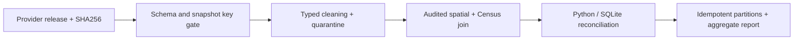

# Airbnb snapshot quality and reporting upgrade

A new, independently reproducible quality slice over **San Francisco** releases
**2026-06-14 and 2026-09-14**. This extends the original collaborative pipeline;
it does not claim that the old VM, Snowflake account or Tableau workbook ran here.



## Actual results

| Release | Raw | Quarantined | Retained | Spatial unmatched | Income available |
|---|---:|---:|---:|---:|---:|
| 2026-06-14 | 7,332 | 4 | 7,328 | 1 | 7,177 |
| 2026-09-14 | 7,405 | 11 | 7,394 | 1 | 7,233 |

All quarantines are missing `minimum_nights`; no imputation or hidden deduplication.
Each release has one approximate tract nonmatch. No multiple spatial matches
occurred. The 244 ACS tracts include 7 special/suppressed income estimates and 6
top-coded estimates; these remain annotated and do not enter numeric means.
20 batch checks and 10 independent SQLite metric reconciliations pass. The test
suite covers failure paths, exact cents, geographic ties and source coding.

The June provider release contains 5,712 rows scraped June 14 and 1,620 scraped
June 22. Snapshot identity is the provider release; exact row scrape dates are
preserved and must remain in the stated quarter. It is not a single-day census.
See [investigation log](docs/investigations.md).

## Reproduce

Python 3.12. From the repository root:

```bash
python3 -m venv .venv
source .venv/bin/activate
pip install -r qc/requirements.lock.txt
bash qc/run_qc.sh
python -m http.server 8000
# open http://localhost:8000/qc/reports/qc_report.html
```

Missing raw inputs download automatically from the exact official source URLs;
SHA256 locks detect revised or corrupt sources and stop the run. Two per-snapshot
Parquet writes verify identical byte hashes on rerun. Unit/fault tests run before
publication; a failed run removes its READY marker and HTML report. Row-level
partitions/quarantine remain local and are ignored by Git. The local gate is a
full-batch operation; it is not a distributed transaction across multiple jobs.

## Contracts and interpretation

- [Schema and severity policy](docs/schema_contract.json)
- [Source lock](docs/source_lock.json) and [manifest](evidence/source_manifest.csv)
- [Boundary/ACS policy](docs/boundary_policy.md)
- [Baseline inventory / contribution boundary](docs/baseline_inventory.md)
- [SQL reconciliation](docs/metric_reconciliation.sql)
- [Tableau verification checklist](docs/tableau_checklist.md)

Host concentration uses a separate denominator for each snapshot; unknown hosts
are reported. Listing price is advertised USD price, not revenue. Availability is
not occupancy; no demand or booking claim follows from missing listings.
ACS income is regional median household income, with 90% MOE, not host income.
Coordinates are anonymized; generalized cartographic boundaries only approximate
tract context. No address reconstruction and no external identity linkage.

## Original Spark/Airflow integration

The original DAG now includes silver and gold validation tasks before downstream
publication. `scripts/quality_gate.py` checks snapshot key/cardinality, raw-to-silver
membership and row accounting, income sentinels, and silver-to-gold listing keys.
Original silver code preserves income signs, raw codes and MOE; gold host rollups
use city/snapshot/neighborhood/host grain; ingest fails on incomplete loads.
These changes were syntax/structure checked here. They require Spark/Sedona and
the original /shared/data files for cloud execution; do not describe cloud or
Tableau validation as completed.

The original Tableau workbook expects the old host grain and should be refreshed
only after the documented checklist. The local QC HTML uses only the new audited
slice and does not depend on that workbook.

## Source attribution

Listings: [Inside Airbnb](https://insideairbnb.com/get-the-data/), CC BY 4.0;
modified by selecting fields, typing, quarantining and aggregating. Income:
US Census Bureau 2019-2023 ACS five-year B19013, official table-based summary
file. Boundaries: US Census Bureau 2023 cartographic tract file, California,
1:500,000. Raw data is not redistributed here. Code license for the new `qc/`
module is MIT; this does not change original team or data rights.
